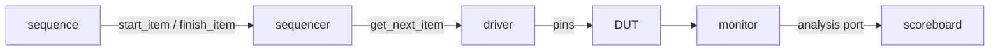

# Solution writing guide (for DV Interview Lab)

You are writing **illustrated model solutions** for ASIC design-verification interview questions.
The site renders GitHub-flavored Markdown plus two diagram languages. Every solution must be
technically correct, interview-ready, and **illustrative**: show the idea, don't just state it.

## What a solution looks like

```
**Key idea:** one or two sentences an interviewer wants to hear first.

<illustration: diagram / waveform / table / worked example>

### Explanation          (or "### Solution" for coding questions)
- concise bullets or short paragraphs

### Code               (coding questions: complete, compilable, commented)
```systemverilog
...
```

### Corner cases & pitfalls
- ...

### Follow-ups
- likely next questions, each with a one-line answer
```

Length: concept questions ~150–350 words; coding/design questions as long as the code needs.
Match the question's language: if the question is in Chinese, write the solution in Traditional
Chinese (technical terms may stay in English).

## Illustration rules (use at least ONE illustration per solution)

Pick the form that best explains the question:

| Question is about | Use |
| --- | --- |
| timing, handshakes, protocols, SVA, clocking, CDC, pipelines, resets | `wavedrom` waveform |
| FSMs, sequence detectors | `mermaid` `stateDiagram-v2` |
| UVM/testbench architecture, data flow, phases, flows | `mermaid` `flowchart` |
| driver↔sequencer, request/response, API call order | `mermaid` `sequenceDiagram` |
| comparisons (X vs Y) | Markdown table |
| algorithms, math, FIFO depth, cache splits | worked numeric example / trace table |
| behavioral (BQ) | STAR table (Situation / Task / Action / Result) with a sample answer |

### Mermaid (fenced block tagged `mermaid`)
Keep syntax simple and valid for Mermaid v10:
- Quote any label containing punctuation: `A["uvm_driver (get_next_item)"]`.
- No HTML except `<br/>`. No semicolons at line ends. No `end` as a node id.
- Never put a backtick inside a Mermaid label (write `uvm_info` without the leading backtick, e.g. "uvm_info macro").
- Edges: `A --> B`, `A -->|label| B`. Subgraphs: `subgraph Name ... end`.
- stateDiagram-v2 transitions: `S0 --> S1: 1/0`.



### WaveDrom (fenced block tagged `wavedrom`) — must be **strict JSON** (double quotes, no comments, no trailing commas)
```wavedrom
{ "signal": [
  { "name": "clk",   "wave": "p......" },
  { "name": "valid", "wave": "01..0.." },
  { "name": "ready", "wave": "0.1.0.." },
  { "name": "data",  "wave": "x=..x..", "data": ["D0"] }
],
  "head": { "text": "transfer happens when valid && ready on a rising edge" } }
```
Wave chars: `p` clock, `0 1` levels, `x` unknown, `=` data (labels from `data`), `.` hold,
`z` high-Z, `|` gap. Every signal's wave string should have the same length.

### Code
Fence with a language tag: `systemverilog`, `verilog`, `python`, `cpp`, `c`, `bash`, `tcl`.
Code must be correct and idiomatic (UVM 1.2 / IEEE 1800-2017). Prefer complete snippets.

## Output files

All output is UTF-8 JSON. Validate before finishing:
`python3 -c "import json,sys; json.load(open(sys.argv[1]))" <file>`
(also check every `wavedrom` block parses as JSON — the helper below does both).

```
python3 scripts/check_solutions.py <file>
```

### A) Solutions for existing questions → `data/solutions/<batch>.json`
```json
{ "<question id>": "markdown solution", "...": "..." }
```
Write one entry for **every** id in your input batch. Do not change ids.

### B) New question sets → `data/manual/<set>.json`
```json
{
  "source": { "id": "short-id", "name": "Human readable source name", "url": "optional" },
  "questions": [
    {
      "title": "The question, phrased as the interviewer would ask it",
      "prompt": "optional extra problem statement (constraints, code to analyze, I/O spec)",
      "answer": "optional: short notes taken from the source material",
      "solution": "illustrated model solution (markdown, follows this guide)",
      "category": "one of the categories below",
      "difficulty": "Easy | Medium | Hard",
      "type": "concept | coding | behavioral",
      "language": "systemverilog | verilog | python | cpp | c | text"
    }
  ]
}
```

Categories: `UVM`, `SystemVerilog`, `SV Constraints`, `SVA`, `Digital Design`, `CDC & Timing`,
`Protocols`, `Verification Planning`, `Coding & Scripting`, `Computer Architecture`,
`Circuits & Analog`, `Behavioral`, `Puzzles`, `Physical Design & STA`, `Low Power`.

Skip items that are not questions (headings, tips, resource lists). Merge exact duplicates.
